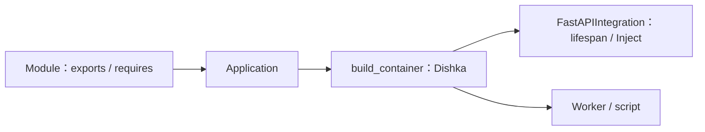

# FastAPI-Fin

FastAPI-Fin 是 FastAPI 的 contract-first 依賴注入擴充。先定義服務介面，再由 Dishka provider 綁定實作；FastAPI 繼續負責路由、Pydantic 驗證與 OpenAPI。

- **模組契約**：以 `Module.exports` 公開契約、以 `Module.requires` 宣告跨模組依賴；組裝時驗證依賴圖。
- **原生 FastAPI**：以 `Inject[T]` 和 lifespan 整合。不需 middleware、專用 route class 或 endpoint decorator。
- **可隔離測試**：以 `Application.with_overrides()` 在新容器替換契約；worker 與測試可直接使用 `open_container()`。
- **直接使用 Dishka**：以原生 `Provider`、`provide`、`Scope` 宣告建構、作用域和清理。

## 快速開始

需要 Python 3.12 以上。安裝套件與 Uvicorn：

```console
pip install fastapi-fin uvicorn
```

若使用 uv，改為 `uv add fastapi-fin uvicorn`。以下程式可存為 `main.py`：

```python
from typing import Protocol

from dishka import Provider, Scope, provide
from fastapi import FastAPI

from fastapi_fin import Application, FastAPIIntegration, Inject, Module


class Message(Protocol):
    def text(self) -> str: ...


class Hello:
    def text(self) -> str:
        return "hello"


class Messages(Provider):
    message = provide(Hello, provides=Message, scope=Scope.APP)


services = Application((Module("messages", providers=(Messages(),), exports=(Message,)),))
app = FastAPI(lifespan=FastAPIIntegration(services).lifespan)


@app.get("/")
def hello(message: Inject[Message]) -> dict[str, str]:
    return {"message": message.text()}
```

以 Uvicorn 啟動並測試：

```console
uvicorn main:app
curl http://127.0.0.1:8000/
```

回應為 `{"message":"hello"}`。FastAPI-Fin 只需要 ASGI lifespan，所以與 Uvicorn（含 `--workers`）的搭配方式和一般 FastAPI app 相同；啟動、關閉與多 worker 的行為見[使用 Uvicorn 啟動](docs/guide/deployment.md)。

## 組裝邊界



[使用文件](docs/index.md) · [可執行範例](examples/README.md) · [開發指南](CONTRIBUTING.md)

