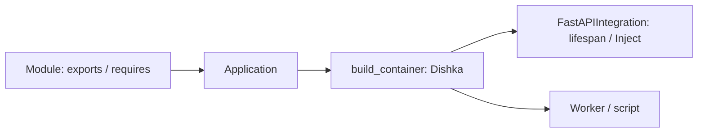

# FastAPI-Fin

FastAPI-Fin is a contract-first dependency injection extension for FastAPI. You define service interfaces first, then bind implementations with Dishka providers. FastAPI keeps handling routing, Pydantic validation, and OpenAPI.

- **Module contracts**: `Module.exports` publishes contracts and `Module.requires` declares cross-module dependencies. The dependency graph is validated at assembly time.
- **Native FastAPI**: integrate with `Inject[T]` and a lifespan. No middleware, custom route class, or endpoint decorator is needed.
- **Isolated testing**: `Application.with_overrides()` replaces a contract in a new container. Workers and tests can use `open_container()` directly.
- **Plain Dishka**: build, scope, and clean up services with the native `Provider`, `provide`, and `Scope`.

## Quick start

Requires Python 3.12 or later. Install the package and Uvicorn:

```console
pip install fastapi-fin uvicorn
```

With uv, use `uv add fastapi-fin uvicorn` instead. Save the following as `main.py`:

```python
from typing import Protocol

from dishka import Provider, Scope, provide
from fastapi import FastAPI

from fastapi_fin import Application, FastAPIIntegration, Inject, Module


class Message(Protocol):
    def text(self) -> str: ...


class Hello:
    def text(self) -> str:
        return "hello"


class Messages(Provider):
    message = provide(Hello, provides=Message, scope=Scope.APP)


services = Application((Module("messages", providers=(Messages(),), exports=(Message,)),))
app = FastAPI(lifespan=FastAPIIntegration(services).lifespan)


@app.get("/")
def hello(message: Inject[Message]) -> dict[str, str]:
    return {"message": message.text()}
```

Start it with Uvicorn and try it:

```console
uvicorn main:app
curl http://127.0.0.1:8000/
```

The response is `{"message":"hello"}`. FastAPI-Fin only needs the ASGI lifespan, so it works with Uvicorn (including `--workers`) like any other FastAPI app. For startup, shutdown, and multi-worker behavior, see [Running with Uvicorn](docs/guide/deployment.md).

## Assembly overview



[Documentation](docs/index.md) · [Runnable examples](examples/README.md) · [Contributing](CONTRIBUTING.md)
